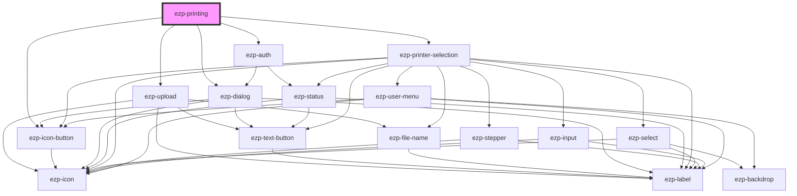

# ezp-root

## Signing in through the host page (`tokenProvider`)

A host page that already has an access token for its signed-in user can lend
it to the widget. The widget then uses that token for the print API and does
not ask the user to sign in, so its sign-in pop-up never opens.

`tokenProvider` is a JS property, not an attribute. Set it to a function that
returns a promise of the access token, or of `null` when nobody is signed in.

```html
<ezp-printing id="printing" clientid="..." redirecturi="..." trigger="button" hidelogin>
</ezp-printing>

<script>
  const printing = document.getElementById('printing')
  printing.tokenProvider = async () => {
    // Whatever the host page signs its users in with.
    const session = await hostAuth.getSession()
    return session ? session.accessToken : null
  }
</script>
```

What the function has to do

- Answer quickly. The widget waits for it when a flow starts, so return a
  cached token, and go to the network only when that token is about to expire.
  The widget waits 20 seconds at most. After that it carries on as if the
  promise had rejected, an answer that comes later is ignored, and the next
  time it needs a token it asks again.
- Answer `null` when nobody is signed in, and only then. The widget then
  forgets the token it was given and falls back to its own sign-in, as without
  a provider.
- Reject when the token can't be had just now, say the host's own token
  service can't be reached. The widget keeps the token it was given earlier,
  so a flow that is under way carries on with it, until the next answer
  replaces it; a 401 from the print API makes it ask again. Without a token
  from the provider to keep, a rejection is the same as `null`.
- Return the token that is current at the time. The widget asks when it loads,
  at the start and end of each flow, every 30 minutes, and after the print API
  or the account service answers a request with 401. A user who switched
  account or organization in between is picked up by the next flow.

What the widget does with it

- The token is kept in memory only. Nothing about it is written to
  `localStorage`, and the widget does not refresh or revoke it.
- With `hidelogin`, a user who is signed in on the host goes straight to the
  print options, whatever the `trigger` (`custom` included). When the provider
  has no token and there is no session of the widget's own, `trigger="button"`
  and `"file"` show the sign-in dialog instead of opening the sign-in pop-up
  straight away: the flow waited for the provider, and after that wait a
  browser may block a pop-up the user's click opened. The dialog's button
  opens it. Without a provider nothing waits, and the pop-up opens at once as
  before.
- `logOut()` signs the user out of the widget only. The next flow asks the
  provider again, so have it answer `null` to keep the user signed out.
- Assign the property once. Each new function makes the widget check the
  session again, which asks the provider and calls the print API, so a
  framework that passes a fresh arrow function on every render pays for a
  check on every render. Replacing it during a flow is safe, as the flow waits
  for the new one.
- Setting `tokenProvider` to `undefined`, or taking the element off the page,
  makes the widget forget that provider and, unless another element on the
  page still has one, the token it gave.

<!-- Auto Generated Below -->


## Properties

| Property          | Attribute         | Description                                                                                                                                                                                                                                                                                  | Type                                                                               | Default     |
| ----------------- | ----------------- | -------------------------------------------------------------------------------------------------------------------------------------------------------------------------------------------------------------------------------------------------------------------------------------------- | ---------------------------------------------------------------------------------- | ----------- |
| `appearance`      | `appearance`      |                                                                                                                                                                                                                                                                                              | `"dark" \| "light" \| "system"`                                                    | `'system'`  |
| `authapihosturl`  | `authapihosturl`  |                                                                                                                                                                                                                                                                                              | `string`                                                                           | `undefined` |
| `clientid`        | `clientid`        |                                                                                                                                                                                                                                                                                              | `string`                                                                           | `undefined` |
| `code`            | `code`            |                                                                                                                                                                                                                                                                                              | `string`                                                                           | `undefined` |
| `custom`          | `custom`          |                                                                                                                                                                                                                                                                                              | `boolean`                                                                          | `undefined` |
| `filedata`        | `filedata`        |                                                                                                                                                                                                                                                                                              | `string`                                                                           | `undefined` |
| `fileid`          | `fileid`          |                                                                                                                                                                                                                                                                                              | `string`                                                                           | `undefined` |
| `filename`        | `filename`        |                                                                                                                                                                                                                                                                                              | `string`                                                                           | `''`        |
| `filetype`        | `filetype`        |                                                                                                                                                                                                                                                                                              | `string`                                                                           | `undefined` |
| `fileurl`         | `fileurl`         |                                                                                                                                                                                                                                                                                              | `string`                                                                           | `undefined` |
| `hideheader`      | `hideheader`      |                                                                                                                                                                                                                                                                                              | `boolean`                                                                          | `false`     |
| `hidelogin`       | `hidelogin`       |                                                                                                                                                                                                                                                                                              | `boolean`                                                                          | `undefined` |
| `hidemenu`        | `hidemenu`        |                                                                                                                                                                                                                                                                                              | `boolean`                                                                          | `false`     |
| `language`        | `language`        |                                                                                                                                                                                                                                                                                              | `string`                                                                           | `''`        |
| `printapihosturl` | `printapihosturl` |                                                                                                                                                                                                                                                                                              | `string`                                                                           | `undefined` |
| `redirecturi`     | `redirecturi`     |                                                                                                                                                                                                                                                                                              | `string`                                                                           | `undefined` |
| `seamless`        | `seamless`        |                                                                                                                                                                                                                                                                                              | `boolean`                                                                          | `false`     |
| `theme`           | `theme`           |                                                                                                                                                                                                                                                                                              | `"blue" \| "cyan" \| "green" \| "orange" \| "pink" \| "red" \| "teal" \| "violet"` | `'cyan'`    |
| `tokenProvider`   | --                | Lets a host page that already has an access token for its signed-in user lend it to the widget, so the user is not asked to sign in again. A function returning a promise of the token, or of `null` when nobody is signed in. Set it as a JS property; it has no attribute. See the readme. | `(() => Promise<string \| null>) \| undefined`                                     | `undefined` |
| `trigger`         | `trigger`         |                                                                                                                                                                                                                                                                                              | `"button" \| "custom" \| "file"`                                                   | `undefined` |


## Events

| Event           | Description                                                                                                                                                                                                                                                                                                                                                                                                                                     | Type                |
| --------------- | ----------------------------------------------------------------------------------------------------------------------------------------------------------------------------------------------------------------------------------------------------------------------------------------------------------------------------------------------------------------------------------------------------------------------------------------------- | ------------------- |
| `printFinished` | Fired when the print flow reaches an end state and the host may dismiss the component: a print job was submitted, or the user cancelled on the upload card, the sign-in dialog (with files pending) or the print options card. A cancel on the print options card returns to the upload card when there is one (`trigger="file"`), so it doesn't end the flow there. It does not mean a job was printed — check for that on the print API side. | `CustomEvent<void>` |


## Methods

### `checkAuth() => Promise<boolean>`


#### Returns

Type: `Promise<boolean>`


### `getAuthUri() => Promise<string>`


#### Returns

Type: `Promise<string>`


### `getSasUri() => Promise<string>`


#### Returns

Type: `Promise<string>`


### `logOut() => Promise<void>`


#### Returns

Type: `Promise<void>`


### `open() => Promise<void>`


Public methods

#### Returns

Type: `Promise<void>`


### `setAuthRefreshToken(refreshToken: string) => Promise<void>`


#### Parameters

| Name           | Type     | Description |
| -------------- | -------- | ----------- |
| `refreshToken` | `string` |             |

#### Returns

Type: `Promise<void>`


## Dependencies

### Depends on

- [ezp-upload](../ezp-upload)
- [ezp-icon-button](../ezp-icon-button)
- [ezp-auth](../ezp-auth)
- [ezp-printer-selection](../ezp-printer-selection)
- [ezp-dialog](../ezp-dialog)

### Graph


----------------------------------------------


